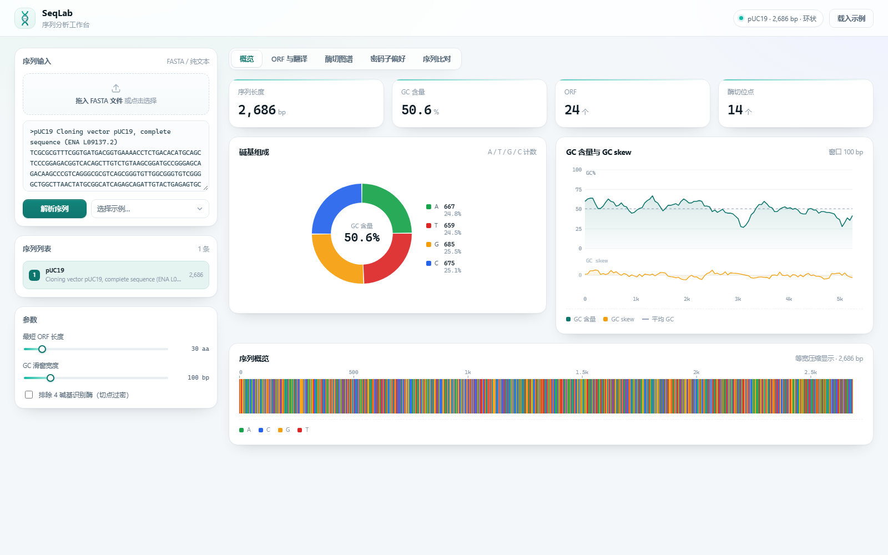
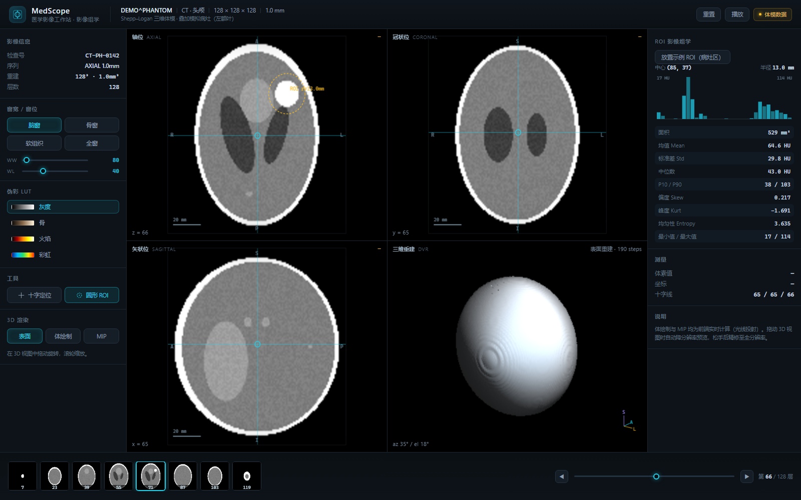
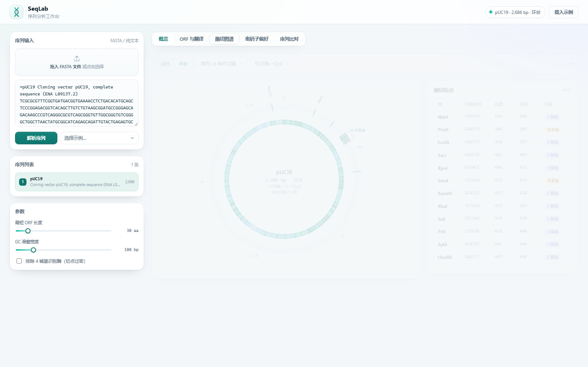
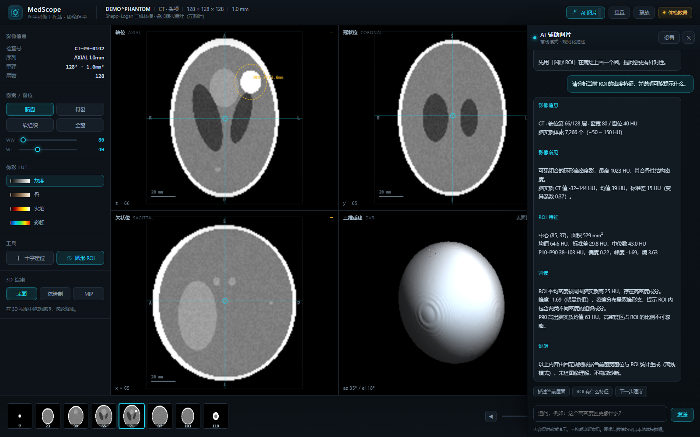

# 生物信息学课程设计 · 两份

> 两个纯前端、零依赖、可离线运行的课程项目：一个**分子序列分析工作台**，一个**医学影像工作站**（含 AI 识图）。
>
> Two self-contained, dependency-free bioinformatics toys: a DNA/protein sequence workbench and a medical imaging workstation with vision-LLM reading.

<p align="center">
  
  
</p>

---

## 目录结构

```
bioinfo2026/
├─ 01-SeqLab/            序列分析工作台
│  ├─ index.html
│  ├─ styles.css
│  ├─ app.js
│  └─ samples.js         内置示例序列（构建时生成）
├─ 02-Imaging/           医学影像工作站
│  ├─ index.html
│  ├─ styles.css
│  └─ app.js
├─ _data/                示例序列的获取与生成脚本
├─ assets/               README 截图
├─ serve.cjs             本地静态服务（Node，无依赖）
└─ 启动本地服务.cmd       Windows 一键启动
```

## 快速开始

```bash
# 方式一：一键（Windows）
双击 启动本地服务.cmd        # 浏览器打开 http://localhost:8000/

# 方式二：手动
node serve.cjs               # 需要 Node 18+
# 或者
python -m http.server 8000
```

也可以直接双击 `01-SeqLab/index.html` 或 `02-Imaging/index.html`（`file://` 方式）。
只有使用 AI 阅片的**在线模式**时必须走本地服务，否则会被浏览器跨域拦截。

---

## 01 · SeqLab 序列分析工作台

<p align="center"></p>

| 模块 | 内容 |
| --- | --- |
| 序列输入 | FASTA 拖放 / 文件选择 / 粘贴，支持多序列 |
| 概览 | 碱基组成环图、GC 含量与 GC skew 滑窗曲线、全序列彩色概览条 |
| ORF 与翻译 | 六阅读框 ORF 预测（可调最短长度）、ORF 轨道图、密码子-氨基酸对照 |
| 酶切图谱 | 39 种限制酶、线性 / 环状质粒图（含 GC 含量环）、密集位点自动聚合、位点表 |
| 密码子偏好 | 64 密码子 RSCU 热图、GC3s、ENC（有效密码子数）、氨基酸组成 |
| 序列比对 | Needleman-Wunsch（全局）/ Smith-Waterman（局部）、着色比对、一致度统计、k-mer 点阵图 |

内置示例：**pUC19**（2,686 bp 环状）、**φX174**（5,386 bp）、**人胰岛素 mRNA**（465 bp）、多克隆位点片段。

快捷键：`1`–`5` 切换标签页。

## 02 · MedScope 医学影像工作站

<p align="center"></p>

| 模块 | 内容 |
| --- | --- |
| MPR 三视图 | 轴位 / 冠状位 / 矢状位同步十字定位、滚轮翻层、方位标记与比例尺 |
| 窗宽窗位 | 脑窗 / 骨窗 / 软组织 / 全窗预设，WW / WL 实时调节 |
| 伪彩 | 灰度、骨、火焰、彩虹四种 LUT |
| 三维重建 | 等值面表面重建（法线光照）、半透明体绘制（DVR）、去骨 MIP，拖动旋转、滚轮缩放 |
| ROI 影像组学 | 画圆选区，统计均值 / 标准差 / 中位数 / P10–P90 / 偏度 / 峰度 / 香农熵，并绘制直方图 |
| AI 辅助阅片 | 离线规则化报告；配置接口后可把当前切片发给多模态大模型流式问答 |

---

## AI 阅片怎么配

面板默认走**离线模式**（按窗宽窗位与 ROI 特征生成规则化描述），不联网也能演示。
在「AI 阅片 → 设置」里填入任意 OpenAI 兼容的多模态接口即可切换为在线识图对话：

| 方式 | 需要什么 | 说明 |
| --- | --- | --- |
| 云端 API | 一个 Key | 内置模力方舟、通义 Qwen-VL、智谱 GLM-4V、火山豆包、OpenAI 预设 |
| 本地 Ollama | 装 Ollama + 视觉模型 | 免费、不出网，Key 留空即可 |

填完先点**测试连接**（只发一句文字，不传图），确认地址 / Key / 模型名无误再正式提问。

> Key 只保存在浏览器的 `localStorage`，不会写进仓库、也不会发给除你配置的接口之外的任何地方。

## 数据来源

- **真实序列**（公开数据库）：
  - φX174 噬菌体基因组 — ENA `J02482.1`，5,386 bp
  - pUC19 克隆载体 — ENA `L09137.2`，2,686 bp
  - 人胰岛素 mRNA — Ensembl `ENST00000381330.5`，465 bp
  - `_data/gen-samples.mjs` 保留了获取与生成脚本，可复现
- **影像数据**：Shepp–Logan 三维体模（医学影像重建算法的标准测试体，128³），
  另叠加一个模拟高密度病灶用于 ROI 演示。**属合成数据，不含任何真实患者信息。**

## 技术说明

- 全部为原生 HTML / CSS / JavaScript，**无框架、无构建步骤、无第三方运行时依赖**
- 图表由 Canvas 2D 手绘，三维重建为光线投射（等值面 + 体绘制 + MIP）
- 统计量（Welch t 检验所需分布、RSCU、ENC、PCA、层次聚类）均为独立实现
- `serve.cjs` 仅 100 余行，用于本地预览与规避 `file://` 跨域

## 安全

仓库自带 `.githooks/pre-commit`：提交前扫描暂存区里的常见密钥格式
（`sk-…`、`ghp_…`、`AKIA…`、私钥头等），命中即阻止提交。

克隆后启用一次：

```bash
git config core.hooksPath .githooks
```

误报时可用 `git commit --no-verify` 跳过。

## 已知限制

- 影像为合成体模，**不是真实病例**，任何结论都没有临床意义
- AI 在线模式需要自备 Key；模型对合成图像的判读会比较泛
- `启动本地服务.cmd` 仅 Windows 可用（`node serve.cjs` 本身跨平台）

## 免责声明

本项目仅用于课程教学与技术演示，**不构成任何诊断意见**，不可用于临床决策。

## License

[MIT](LICENSE)
